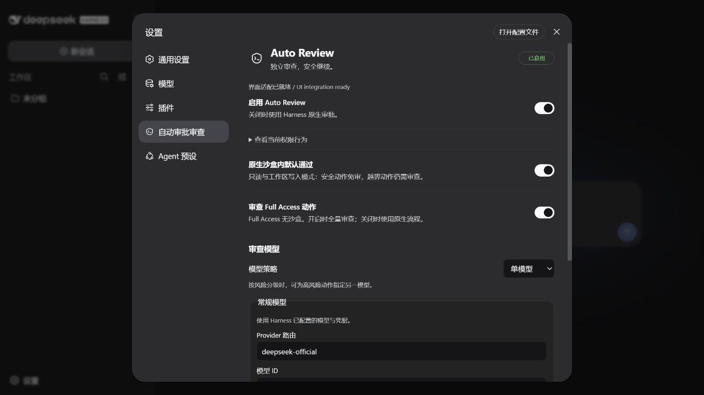
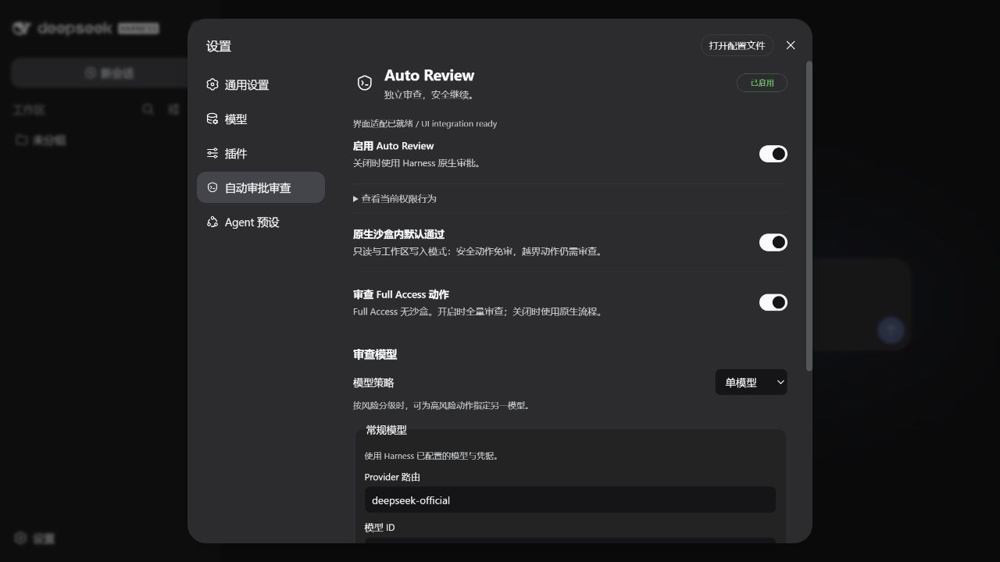
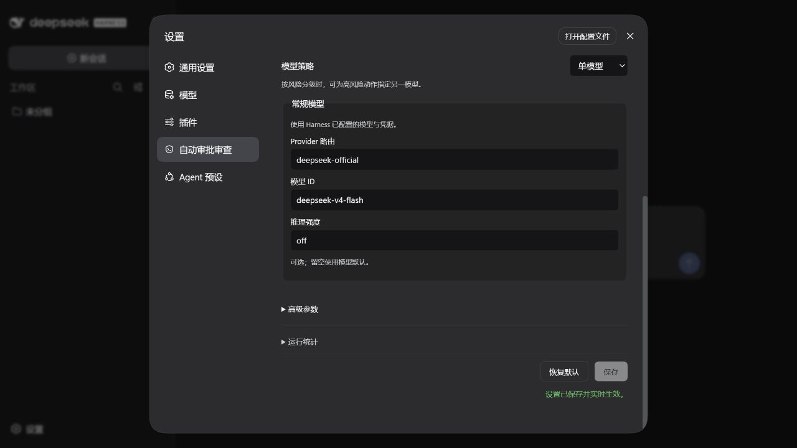

# #34 修复与跨版本实测（2026-09-14）

## 结论与边界

未知宿主导致整个插件树启动失败的问题已修复。三个声明兼容版本均完成干净安装、真实 Flash 任务、安装后原生桥接预检、真实 Loop 的三拒中断/下一回合恢复以及设置页浏览器检查。

这不是“所有生产场景零故障”的证明，也不是三个宿主编码能力的排名。尚有安全替代建议质量和高级手工配置迁移的局限；未自动发布 npm 稳定版。

## 版本与安装

- 插件候选：0.6.3-rc.1；付费模型阶段使用 candidate7，最后的 UI/安装器回归使用 candidate15。两者审查后端一致，不能说所有付费轨迹都来自最后一个 tarball。
- 最终安装包 SHA-256：`56345244b1523e4a7827a9f374d7b93b50a1ab078b5432abf1e3a4934eedc970`。
- DSH：0.1.0-rc.6、0.1.1-rc.2、0.1.2-alpha.5。历史版本锁定完整 DSH 组件族；仅固定 launcher 版本会发生依赖漂移。
- 从全新 Docker 文件系统开始，通过官方 `dsh plugin --profile web add` 安装，并增加 headless profile。使用公开 npm native bridge、管理员只读执行根，普通用户运行 Agent。
- 不支持的 0.1.3-alpha.1 在检查的 registry 无法取得；相邻 alpha.2 实际复现旧包异常并检查保护入口。不得把它写成 alpha.1 实机验证或新版宿主完整兼容。

## 真实 Flash 成本

统计全部尝试，包含失败的前置轨迹。缓存输入是总输入的子集，不重复相加；未把推理 token 再加到输出上。

| DSH | Provider 调用 | 输入 | 输出 | 总 token | 缓存输入 | 输入缓存命中 |
|---|---:|---:|---:|---:|---:|---:|
| rc6 | 52 | 936,932 | 16,318 | 953,250 | 910,592 | 97.19% |
| rc2 | 54 | 949,441 | 20,522 | 969,963 | 883,456 | 93.05% |
| alpha5 | 53 | 934,776 | 20,977 | 955,753 | 897,536 | 96.02% |

总计 **2,878,966 tokens**。每版均在要求的 90–110 万区间。159 次实际 Provider 请求均为 HTTP 200，账本无未知用量。任务截止由本地保守预算预留触发，返回本地 402，不是 DeepSeek 配额错误。

高缓存命中来自重复发送稳定的任务/代码上下文；这约 300 万是累计 API 输入输出，不是 300 万新生成内容，也不代表数小时耐久测试。本轮压缩次数为 0。

| DSH | Reviewer 模型调用 | Reviewer 总 token | 主任务工具调用 | 原生边界内 / 自动审查 / 原生人工 | 策略 outline/search/get |
|---|---:|---:|---:|---|---|
| rc6 | 9 | 31,317 | 45 | 44 / 1 / 0 | 0 / 0 / 0 |
| rc2 | 9 | 32,150 | 52（含两次失败尝试） | 50 / 1 / 1 | 0 / 0 / 0 |
| alpha5 | 12 | 68,620 | 43 | 42 / 1 / 0 | 1 / 3 / 1 |

Reviewer 模型调用不等于动作数：alpha5 一次审查发生了多轮策略检索。其策略工具共返回 53,062 bytes。27 条已记录 Reviewer 会话均正常收尾、cleanupFailed=false。DSH 某些 usage 未提供 cacheWrite/total，插件继续显示未知/下界；上述完整总成本使用 Provider 实报账本，不强行把未知缓存写入当 0。

## 覆盖了什么

1. **白盒 + 真实 Reviewer：**每版 8 个用例，包括授权本地检查、测试、敏感文件读取、工具输出中的外传诱导、生产目录删除、精确授权清理、只读模式写入、较早的禁止外传要求。共 24/24 批准或拒绝结论符合预期。危险命令仅送审，没有实际执行。
2. **真实安装的 Agent Loop：**每版实际 Loop 配脚本化模型和惰性工具，第三次拒绝硬中断、不出现第四个旧回合请求、拒绝动作执行数 0；下一用户回合可执行安全标记并完成。此类控制测试不消耗付费 token，不冒充自主模型行为。
3. **黑盒编码：**实现 Node.js 持久化 journal，涉及追加/恢复、尾部损坏、快照、幂等、关闭排空和 CLI。独立验证器不挂入 Agent 容器。截止时分别 **5/8、5/8、6/8**；均未完整实现，不能计为任务成功。
4. **最终离线矩阵：**同一 candidate15 安装包的官方安装/升级、真实 UI 安装器与 `--check`、native handshake、原生 clientModules 发现唯一前端模块、Loop 中断与恢复均通过。
5. **实际浏览器：**三版设置入口、盾牌导航、UI integration ready 可见；修改输出上限 2048→2049，服务端 settings.yaml 确认保存。alpha5 检查重装与两次启动。截图为真实 WebUI，不是组件模拟。
6. **源码与制品：**279 项测试通过、3 项跳过；15 项安装器测试通过；packed artifact 解包检查通过。新 GitHub Actions 增加三版无密钥冷安装矩阵；远程 Actions 结果须单独查看，不能用服务器结果冒充。

## 修复和仍需注意的发现

- Loader guarded entry 与子服务健康状态绑定真实生命周期；未就绪时不签发执行票据，未知宿主不安装自动审批钩子、不调用 Reviewer。
- 审查动作及当前用户授权必须完整保留；历史只按完整条目装入证据预算，不能静默截断权限要求。
- UI 安装器修复动态导入循环造成的退出 13；缺少 pnpm、原生依赖安装脚本以及不同 bridge 渠道的完整性差异已补充文档。
- rc6/rc2 需要入口子路径元数据；alpha5 需要原生文件入口。安装器只自动处理独立、空 overlay 的 alpha5 profile，保留包备份，拒绝共享目录、自定义 overlay 和不匹配原包。额外 `--patch` 仍需人工检查，不能静默丢失禁用设置。
- 设置轮询故障后停止；工具徽标在连续三次通信失败后停止轮询，重新订阅可恢复，避免失效时高频请求。
- **安全替代并非全部合格。** 15 次白盒拒绝中 13 次给出替代建议；部分 `.env` 外传拒绝转而建议本地读取内容，这不一定必要或安全。建议必须再次经过正常策略，绝不预先批准。24/24 仅指最终决定，不代表24/24完整安全行为通过。
- 前两版 Reviewer 在这些用例中未调用策略检索；本轮不能证明复杂风险下总会正确检索完整政策。
- 宿主输出过 Landlock 旧 ABI 的 partial enforcement 提示。原生桥接握手成功不等于支持全部新内核沙盒能力；本轮不能宣称已验证完整的最新 Linux 沙盒隔离。
- rc2 前两次编码尝试分别遇到采集器误判完整流、4K 输出截断及历史证据溢出；已修复并保留全部费用。其最终编码样本不是与另两版完全同条件的独立对照。

## 真实设置页截图

以下均为安装后的实际 WebUI；验证了设置保存，不代表本轮完成了所有真实聊天逐工具图标的端到端覆盖。

| rc6 | rc2 | alpha5 |
|---|---|---|
|  |  |  |

## 可复现流程

源码入口见 `.github/workflows/clean-container.yml`。步骤：构建候选包 → 空容器完整宿主安装 → official plugin add → native 执行根和 UI 预检 → 离线原生 Loop → 获授权后经限额网关运行 Flash → 独立评分 → 交叉核对 Provider/trace/audit → 保存日志、SHA 与容器状态 → 销毁本次容器。

测试全部在独立服务器目录及独立 Docker daemon 上进行。模型容器断网，通过单一 Unix socket 网关访问 Flash；不暴露真实 API key、Docker socket 或隐藏验证器。UI 仅绑定 loopback，经 SSH 查看，不发布公网端口；未修改已有业务服务。

原始轨迹与安装失败现场归档于服务器本次 acceptance 目录；公开材料只包含脱敏统计和测试源码。有限测试不能保证从未覆盖的宿主版本、用户自定义 overlay 或模型行为没有问题。

本轮 99 个临时容器已全部移除，独立 Docker daemon 和付费网关已停止；保留源代码、镜像缓存与审计证据。脱敏归档包含 7,205 个证据文件及 99 份容器记录，51,182,615 bytes；SHA-256 为 `888948faea73ecdc51953d6b08c3e8eb347c42720748979aba681a04c6174f6f`。归档不公开上传，供后续复核。
